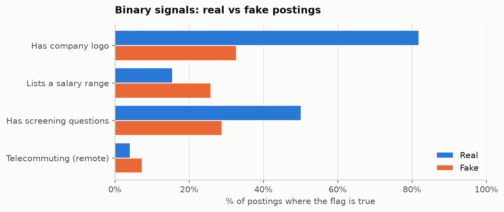
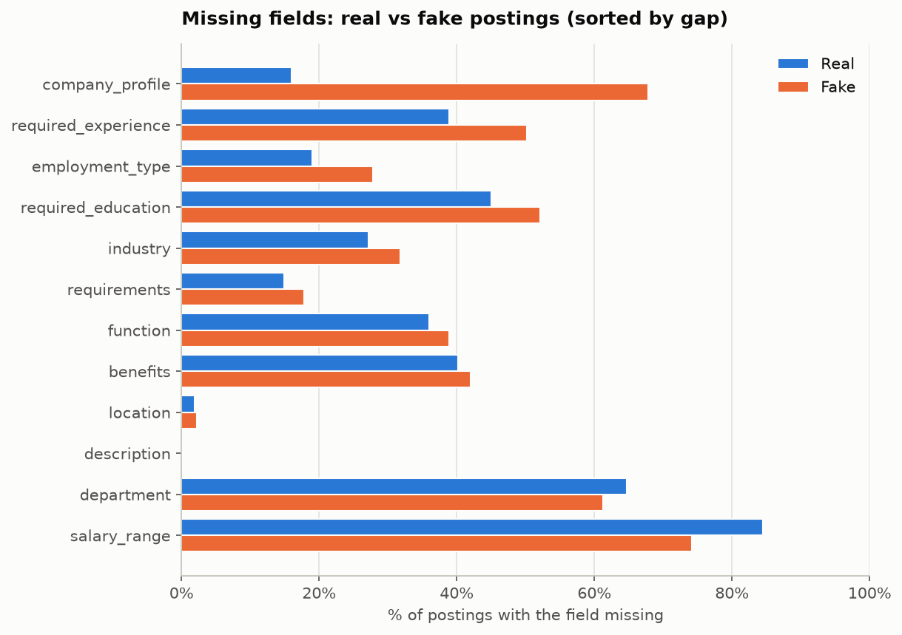
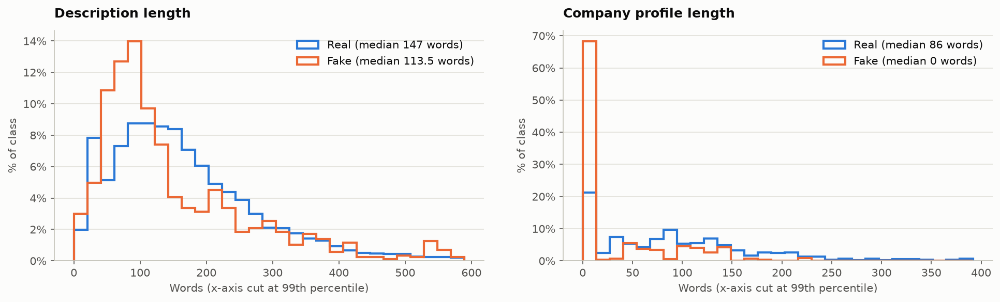
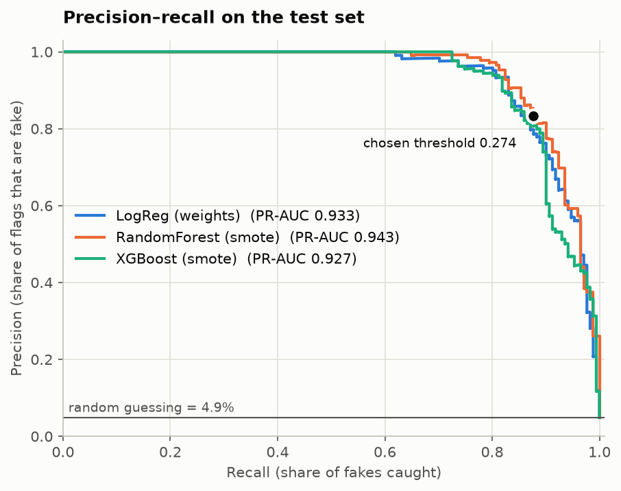
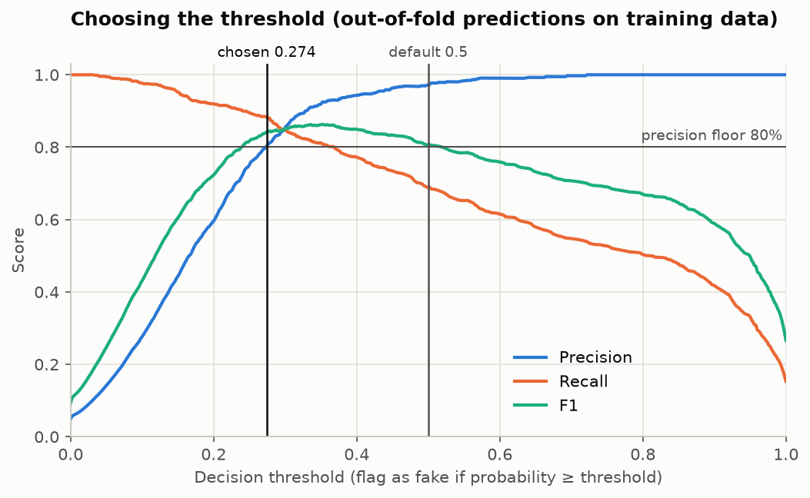
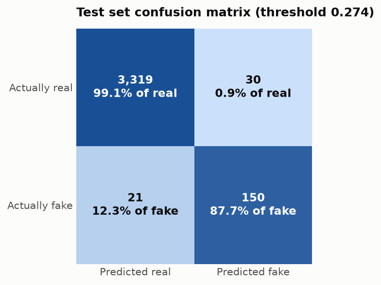
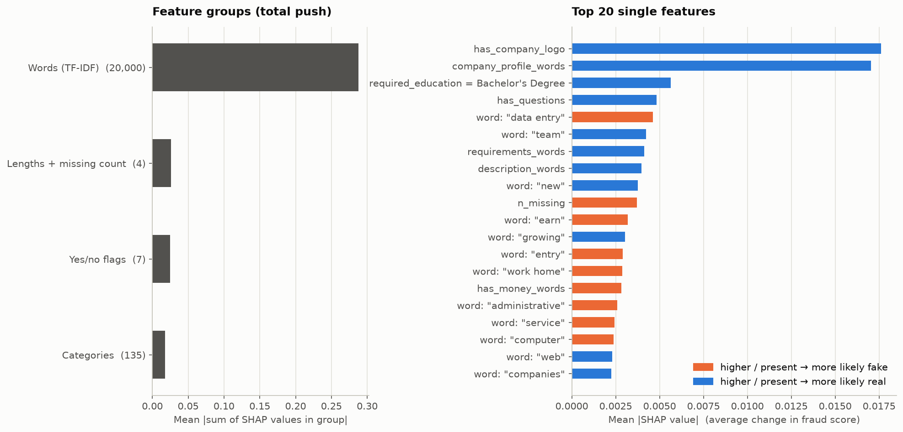
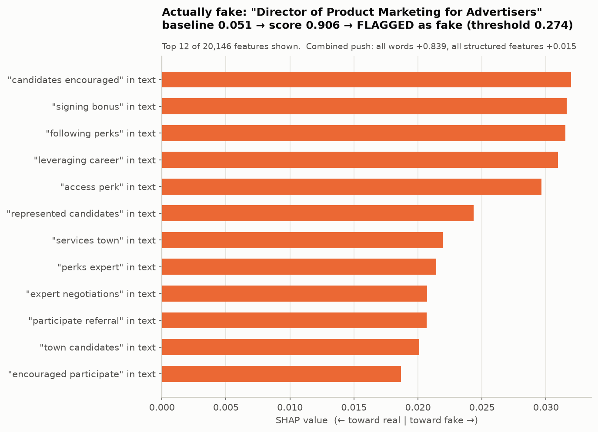
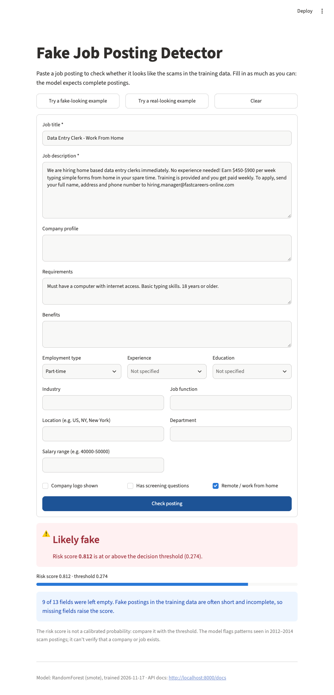

# Fake Job Posting Detector

A machine-learning service that flags fraudulent job postings from their text and metadata. It covers the full workflow:
- exploratory analysis
- a leakage-safe scikit-learn pipeline
- comparison of 3 models × 3 ways of handling class imbalance
- a decision threshold tuned for the use case
- SHAP explanations
- a FastAPI service in Docker, with a Streamlit front end

**Live demo:** Streamlit page: `<add Render URL>` · API docs: `<add Render URL>/docs`
*(Hosted on Render's free tier: the first request after 15 idle minutes takes about a minute while the service wakes up.)*

### Results at a glance
These come from a held-out test set of **3,520 postings (171 fake)**. The test set was not used for any choice of model, threshold or features.

| Metric | Value |
|---|---|
| PR-AUC (average precision) | **0.943** (a random guess scores 0.049) |
| ROC-AUC | **0.994** |
| Recall at the tuned threshold (0.274) | **0.877**: 150 of 171 fakes caught |
| Precision at the tuned threshold | **0.833**: 30 false alarms among 3,349 real postings |

Final model: **Random Forest trained with SMOTE**, selected by 5-fold cross-validation. Its threshold was tuned to catch as many fakes as possible while keeping precision ≥ 0.80.

---

## Contents
[Problem](#problem) · [Dataset](#dataset) · [Approach](#approach) · [EDA](#eda-highlights) · [Model comparison](#model-comparison) · [Threshold](#choosing-the-decision-threshold) · [SHAP](#explainability-shap) · [API](#api) · [Run locally](#run-locally) · [Docker](#docker) · [Limitations](#limitations) · [Future work](#future-work)

## Problem
Fake job postings are used to collect personal data, fees or unpaid work from job seekers. A job board can't review every posting by hand, so it needs a model that ranks postings by risk and sends the suspicious ones for review.

Fakes are rare, about **1 in 20**. A model that calls everything "real" is **95.2% accurate and catches nothing**. So this project measures precision, recall and PR-AUC on the fake class, never accuracy.

## Dataset
EMSCAD (Employment Scam Aegean Dataset), via Kaggle's [Real or Fake Job Posting Prediction](https://www.kaggle.com/datasets/shivamb/real-or-fake-fake-jobposting-prediction) (`fake_job_postings.csv`):
- **17,880 postings** from 2012–2014; **866 (4.84%) are fake**. The target column is `fraudulent`.
- Fields:
  - free text: title, company profile, description, requirements, benefits
  - categories: employment type, experience, education, industry, function
  - other text: location, department, salary range
  - three yes/no flags: company logo, screening questions, remote
- **281 exact duplicates** (identical except for `job_id`) are removed **before** splitting, leaving 17,599. Otherwise a posting could appear in both train and test.
- The CSV is not in this repo. Download it into `data/`.

## Approach
```
raw posting fields
  └─ build_features   clean text (HTML entities, contact tokens, glued words), word counts, missing-field count, flags
      └─ ColumnTransformer
          ├─ TF-IDF, unigrams + bigrams .......... 20,000 features
          ├─ one-hot categories (rare → "other") ....... 135
          ├─ log + scaled word counts, n_missing ......... 4
          └─ yes/no flags ................................ 7   → 20,146 features
              └─ SMOTE (applied only while fitting)
                  └─ Random Forest (500 trees) → risk score → is_fraud = score ≥ 0.274
```
One scikit-learn/imblearn `Pipeline` contains every step. It is fitted on the training data only, and the API runs exactly the same object on raw input.

How leakage is prevented:
1. **Duplicates** are dropped before the split.
2. **The split is stratified** (80/20, seed 42), so both sets keep the 4.84% fake rate.
3. **Every learned step** (vocabulary, scaling, categories, SMOTE) is fitted inside each cross-validation fold.
4. **SMOTE never touches validation or test data.** The imblearn pipeline only resamples while fitting.
5. **The model is chosen by cross-validation score**, and the threshold is tuned on **out-of-fold** training predictions. The test set is used once, for the final report.

| Step | Code |
|---|---|
| EDA (38 cells, all outputs saved) | [`notebooks/01_eda.ipynb`](notebooks/01_eda.ipynb) |
| Cleaning and features | [`src/preprocess.py`](src/preprocess.py) |
| Training, model comparison, threshold | [`src/train.py`](src/train.py) |
| Metrics and plots | [`src/evaluate.py`](src/evaluate.py) |
| SHAP explanations | [`src/explain.py`](src/explain.py) |
| API, page, tests | [`app/main.py`](app/main.py), [`streamlit_app.py`](streamlit_app.py), [`tests/test_api.py`](tests/test_api.py) |

## EDA highlights
Each finding became a feature or a design decision:

| Finding | What it led to |
|---|---|
| Postings **without a company logo are fake 15.9%** of the time, vs **2.0%** with one | `has_company_logo` flag |
| Company profile missing in **67.8% of fakes vs 16.0% of real** postings | Missing values kept as a signal: a `"Missing"` category plus an `n_missing` count, no imputation |
| Fakes are shorter: median description **113.5 vs 147 words**; company profile **0 vs 86** | Log-scaled word-count features |
| Email contact in **20.1% of fakes vs 6.8%**; money words ("$", earn, cash, per week) in **41.1% vs 24.8%** | `has_email`, `has_phone`, `has_money_words` flags |
| Oil & Energy postings are **38% fake**, but its 109 fakes share only **9 company profiles** (72 in Houston) | Scams come in **campaigns**, so test scores may be optimistic (see [Limitations](#limitations)) |





## Model comparison
Each combination of model and imbalance strategy was tuned with `GridSearchCV`, using stratified 5-fold cross-validation scored on PR-AUC.
- **weights** means `class_weight` for LogReg and Random Forest, or `scale_pos_weight` = 19.55 for XGBoost.
- **smote** means SMOTE inside the pipeline.

**The model was chosen on CV PR-AUC.** The test columns are reported for completeness and use the default 0.5 threshold.

| Model | Imbalance | CV PR-AUC (mean ± std) | Test PR-AUC | Test ROC-AUC | Precision@0.5 | Recall@0.5 | F1@0.5 | Accuracy@0.5 |
|---|---|---|---|---|---|---|---|---|
| Dummy (always real) | – | 0.049 ± 0.000 | 0.049 | 0.500 | 0.000 | 0.000 | 0.000 | 0.951 |
| LogReg | none | 0.907 ± 0.019 | 0.932 | 0.992 | 0.957 | 0.784 | 0.862 | 0.988 |
| LogReg | weights | 0.911 ± 0.019 | 0.933 | 0.992 | 0.859 | 0.854 | 0.856 | 0.986 |
| LogReg | smote | 0.908 ± 0.020 | 0.934 | 0.993 | 0.859 | 0.854 | 0.856 | 0.986 |
| RandomForest | none | 0.910 ± 0.009 | 0.940 | 0.993 | 1.000 | 0.655 | 0.792 | 0.983 |
| RandomForest | weights | 0.896 ± 0.013 | 0.917 | 0.992 | 1.000 | 0.602 | 0.752 | 0.981 |
| **RandomForest** | **smote** | **0.922 ± 0.010** | **0.943** | **0.994** | 0.992 | 0.719 | 0.834 | 0.986 |
| XGBoost | none | 0.904 ± 0.021 | 0.921 | 0.990 | 0.968 | 0.713 | 0.822 | 0.985 |
| XGBoost | weights | 0.908 ± 0.019 | 0.928 | 0.989 | 0.952 | 0.807 | 0.873 | 0.989 |
| XGBoost | smote | 0.910 ± 0.020 | 0.927 | 0.991 | 0.950 | 0.784 | 0.859 | 0.988 |

What the table shows:
- **Accuracy is useless here.** The dummy scores 0.951 without catching a single fake.
- **The models are close.** All nine score between 0.896 and 0.922 CV PR-AUC, and the gaps are about the size of the fold-to-fold variation (std 0.01–0.02). Random Forest + SMOTE won on CV, but tuned Logistic Regression (0.911) is a credible, much simpler alternative.
- **The threshold matters more than the model.** At 0.5, the Random Forests are extremely precise (0.99–1.00) but miss 28–40% of fakes. Their scores sit low, so the default threshold is badly placed.

Settings chosen by the grid search:
- LogReg: C = 30 (none, weights) or 10 (smote)
- Random Forest: `max_features="sqrt"`, `min_samples_leaf=1`
- XGBoost: `max_depth=6`, `min_child_weight=1`



## Choosing the decision threshold
A missed scam costs more than an extra posting in the review queue. The rule is therefore: **catch as many fakes as possible while keeping precision ≥ 0.80**, so that at most 1 in 5 flagged postings is a false alarm.

The threshold was chosen on **out-of-fold predictions on the training set**, never on the test set:

| Threshold (out-of-fold, train) | Precision | Recall | F1 |
|---|---|---|---|
| 0.500 (default) | 0.973 | 0.689 | 0.807 |
| 0.352 (best F1) | 0.925 | 0.809 | 0.863 |
| **0.274 (chosen: highest recall with precision ≥ 0.80)** | 0.802 | 0.883 | 0.841 |

On the **test set**, the tuned threshold catches **27 more fakes** at the cost of **29 more false alarms**:

| Test set | Precision | Recall | F1 | Fakes caught | False alarms |
|---|---|---|---|---|---|
| Threshold 0.5 | 0.992 | 0.719 | 0.834 | 123 / 171 | 1 |
| **Threshold 0.274** | **0.833** | **0.877** | **0.855** | **150 / 171** | **30** |




## Explainability (SHAP)
The SHAP values come from interventional TreeSHAP on all 171 test fakes plus 171 random real test postings. The baseline is 200 real **training** postings, so explanations start from realistic data rather than the SMOTE-balanced data the trees were fitted on. Script: [`src/explain.py`](src/explain.py).

- **The strongest single features point toward "real":**
  - having a company logo (mean |SHAP| 0.0176)
  - a longer company profile (0.0170)
  - requiring a Bachelor's degree
  - screening questions
- **Toward "fake":** "data entry", many missing fields, "earn", "work home", money words, "administrative".
- **Text dominates overall.** No single word is in the top two, but the 20,000 word features *together* push the score about **11× more** than any other group (mean total push 0.288, vs ≤ 0.026).



**One flagged fake, explained.** This posting has a company logo, yet scores **0.906**. The words added +0.839 and the structured features only +0.015.

Its top features are phrases from one recurring **scam template** ("represented candidates", "expert negotiations", "signing bonus"). That template appears in **43 training postings, all fake, under 41 different job titles**. SHAP shows the model partly works by recognising known campaigns; see Limitations.



More charts: [beeswarm](reports/figures/10_shap_beeswarm.png) · [a real posting explained](reports/figures/12_shap_example_real.png).

## API
FastAPI service in [`app/main.py`](app/main.py). The model is loaded **once at startup**.

| Method | Path | Returns |
|---|---|---|
| `POST` | `/predict` | `{"fraud_probability": float, "is_fraud": bool, "threshold": float}` |
| `GET` | `/health` | status, model name, threshold, training date |
| `GET` | `/docs` | interactive Swagger UI with two ready-made example postings |

```bash
uvicorn app.main:app --reload

curl -X POST http://127.0.0.1:8000/predict -H "Content-Type: application/json" \
     -d @app/examples/fake_posting.json
# {"fraud_probability":0.812,"is_fraud":true,"threshold":0.274}

curl -X POST http://127.0.0.1:8000/predict -H "Content-Type: application/json" \
     -d @app/examples/real_posting.json
# {"fraud_probability":0.028,"is_fraud":false,"threshold":0.274}
```
Minimal request body. The other fields (company profile, requirements, benefits, categories, location, salary …) are optional but improve the score:
```json
{"title": "Customer Service Representative",
 "description": "Answer customer calls and emails, resolve issues and log tickets.",
 "telecommuting": false, "has_company_logo": true, "has_questions": false}
```

**Input validation (Pydantic):**
- **Required:** title, description and the three flags. A silent default of "no logo" would bias every score toward fake.
- **Fixed lists** for employment type, experience and education.
- **Unknown field names are rejected**, so a typo can't silently drop a field.
- **Blank strings are rejected**, and long text has length limits.

Invalid requests get **HTTP 422** listing every problem at once.

**Postman:** *Import* → paste one of the curl commands above, or import `http://127.0.0.1:8000/openapi.json` to get every endpoint with its examples.

**`fraud_probability` is a risk score, not a calibrated probability.** SMOTE training inflates it: the mean score on the test set is 0.075 against a real fake rate of 0.049. Compare it with `threshold`, which is exactly what `is_fraud` does.

**Performance, measured locally on a laptop:**
- median latency 13.1 ms, p95 13.5 ms, over 100 HTTP requests
- 352–377 MB of RAM. The model is 18.1 MB compressed on disk but about 159 MB in memory.

### Streamlit page
[`streamlit_app.py`](streamlit_app.py) is a thin client: it calls the API over HTTP and contains no model code. Its dropdown options and examples are read from the API's OpenAPI schema, so the page can't drift out of sync with the API.

```bash
uvicorn app.main:app &          # the API
streamlit run streamlit_app.py  # http://localhost:8501  (set API_URL to point at a deployed API)
```


## Run locally
**Setup:** Python 3.11.
```bash
git clone <this-repo> && cd fake-job-detector
uv venv --python 3.11 && source .venv/bin/activate   # or: python3.11 -m venv .venv && source .venv/bin/activate
uv pip install -r requirements.txt                    # or: pip install -r requirements.txt
brew install libomp                                   # macOS only, needed by XGBoost
```
**Data:** download `fake_job_postings.csv` from [Kaggle](https://www.kaggle.com/datasets/shivamb/real-or-fake-fake-jobposting-prediction) and put it in `data/`.

**Reproduce:** every random step uses seed 42. Two full training runs produced identical logs.
```bash
python -m src.preprocess   # feature sanity check
python -m src.train        # 9 grid searches + threshold; 16.4 min on a 10-core laptop -> models/fraud_detector.joblib
python -m src.evaluate     # test metrics -> reports/final_metrics.json, confusion matrix
python -m src.explain      # SHAP charts (~80 s)
jupyter notebook notebooks/01_eda.ipynb
```
**Serve and test:**
```bash
uvicorn app.main:app --reload    # API at http://127.0.0.1:8000/docs
streamlit run streamlit_app.py   # page at http://localhost:8501
python -m pytest -q              # 10 API tests, including "API score == offline pipeline score"
```

## Docker
The image is `python:3.11-slim` with only the serving dependencies ([`requirements-api.txt`](requirements-api.txt)) and runs as a non-root user. The build loads the model once as a check, so a missing or broken model fails the build instead of the running service.
```bash
docker build -t fake-job-detector .                 # uses models/fraud_detector.joblib
docker run --rm -p 8000:8000 fake-job-detector      # API at http://localhost:8000/docs
```
The trained model is not committed to git. For cloud builds it is published as a GitHub release file and downloaded during the build with `--build-arg MODEL_URL=<url>`. **Free deployment on Render, step by step: [DEPLOY.md](DEPLOY.md).**

## Project structure
```
├── app/
│   ├── main.py              FastAPI service
│   └── examples/            example postings (used by the docs, curl and the tests)
├── data/                    fake_job_postings.csv (download yourself, not committed)
├── models/                  fraud_detector.joblib (created by src.train, not committed)
├── notebooks/01_eda.ipynb   exploratory analysis
├── reports/                 model_comparison.md/.csv, final_metrics.json, logs, figures/
├── src/
│   ├── preprocess.py        cleaning + feature pipeline
│   ├── train.py             model comparison, threshold, saving
│   ├── evaluate.py          metrics + plots
│   └── explain.py           SHAP
├── tests/test_api.py
├── streamlit_app.py
├── Dockerfile, .dockerignore
├── requirements.txt         everything (includes the two files below)
├── requirements-api.txt     serving only (Docker image)
├── requirements-ui.txt      Streamlit page only
└── DEPLOY.md
```

## Limitations
1. **Scam campaigns make the test score optimistic.**
   - Fakes come in batches of near-identical ads. Only 631 of the 866 fake descriptions are unique, and Oil & Energy's 109 fakes share 9 company profiles.
   - A random split puts members of the same campaign in both train and test. For example, the template SHAP picked out appears in 43 training postings and 13 test postings, all fake and all caught.
   - Removing that one template only lowers test recall from 0.877 (150/171) to 0.867 (137/158). But the **combined effect of all campaigns hasn't been measured**, and performance on a brand-new kind of scam is likely lower than reported.
2. **Short postings for low-barrier jobs get high scores.** The model learned *what kind of job* a posting is for, as well as *how it is written*. Five postings I wrote by hand to test this:

   | Hand-written test posting | Score | Flagged? |
   |---|---|---|
   | Customer service, title + one-line description only | 0.462 | yes |
   | Same, every field filled but short | 0.288 | yes |
   | Customer service, full realistic text | 0.172 | no |
   | Backend engineer, one sentence per field | 0.048 | no |
   | Backend engineer, full text | 0.028 | no |

   These are probes, not a measured false-positive rate. They suggest that brief but genuine entry-level postings are the most likely false alarms.
3. **Scores aren't calibrated probabilities.** The mean test score is 0.075 against a 0.049 real fake rate. Use `is_fraud` or rank by score; don't read 0.3 as "30% chance".
4. **There are few fakes in the test set.** With 171 fakes, each missed fake moves recall by 0.6 points. The gap between the two best configurations (0.011 CV PR-AUC) is about one fold-to-fold standard deviation (0.010–0.020), so their ranking isn't certain.
5. **The data is old and comes from one source.** The postings date from 2012–2014, so newer scam patterns (e.g. messaging apps, crypto payments) aren't represented.
6. **The model judges the posting, not the company.** It can't check that an employer exists, so a scam that copies a real posting would pass. In the API, `has_company_logo` is whatever the caller says it is.
7. **Contact details differ between training and real input.** The dataset replaced URLs, emails and phone numbers with placeholder tokens, and the pipeline maps real ones to the same tokens. The model has never seen real contact details, only the tokens.

## Future work
- **Group-aware evaluation:** cluster near-duplicate postings (same company profile, or MinHash on the text), split by cluster, and get an honest estimate for unseen campaigns.
- **Calibration** (isotonic or Platt, fitted on out-of-fold predictions), so that `fraud_probability` means what it says.
- **Text embeddings** (sentence-transformers, or a fine-tuned small transformer), compared with TF-IDF under the same CV and threshold rule.
- **Explanations per request:** return the top SHAP reasons from the API and show them on the page.
- **Monitoring:** log score distributions and input completeness to catch drift; retrain on recent postings.
- **A smaller, safer model artifact:** shallower or fewer trees (the trees are currently up to 158 levels deep) for faster cold starts, plus a SHA-256 check on the downloaded model file.
